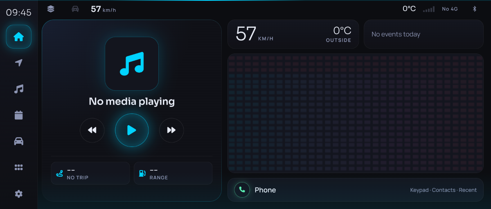
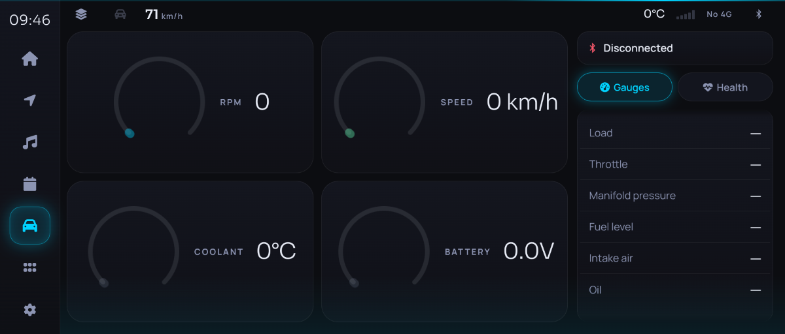
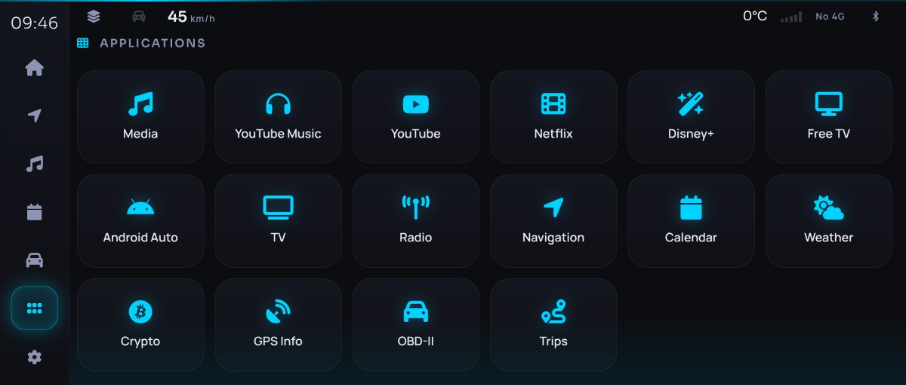

# OrangeCar

**An Orange Pi that plugs into your car's CarPlay port and pretends to be an iPhone, so the car shows
your own dashboard.**

OrangeCar turns an Orange Pi 5 Plus (RK3588) into the *phone side* of **wired Apple CarPlay**. The car
believes an iPhone is connected. What it actually displays is a web dashboard running on the board:
offline navigation, music, OBD-II engine data, trips and fuel, 4G, phone calls. You control it from the
car's touchscreen and steering-wheel buttons.

You don't need an iPhone, an MFi authentication chip or a jailbreak. The project has run end to end in
a production car (Jaguar F-PACE, InControl head unit) for daily driving.

<p align="center">
  
</p>
<p align="center">
  
  
</p>
<p align="center"><sub>Screenshots taken at the car's native 1200x512 resolution, with simulated data.</sub></p>

> **Why this exists.** Projects that implement the *receiver* side of CarPlay (head units, dongle
> firmware) exist. A working, open, end-to-end *transmitter* that a real car accepts did not seem to.
> Getting there meant reverse-engineering USB role switching, iAP2 over USB, the CDC-NCM tunnel, the
> car's timers and the CarPlay session itself. All of it is written down in
> [docs/protocol.md](docs/protocol.md), so you don't have to repeat it.

## What it does

| On the car screen | Behind it |
|---|---|
| Home: clock, speed, next turn, range, now playing | GPS from the **car itself** over iAP2, OBD-II over Bluetooth |
| Navigation | Offline MapLibre vector maps + Valhalla routing on the board, live traffic optional |
| Music | YouTube Music, internet radio, lyrics, visualiser. Audio goes to the car speakers through CarPlay audio streams |
| Engine | Live OBD-II PIDs, trouble codes, misfires, emission monitors, health checks |
| Trips & fuel | Automatic trip log, fuel used per trip, a "fuel wallet" that learns from your refills |
| 4G | SIMCom SIM7600 modem: data, signal, usage per day and billing cycle |
| Phone | Calls through the 4G modem using the car's microphone and speakers (experimental) |
| Steering wheel | Next/previous/play/pause and phone keys reach the dashboard |
| Now Playing | The car's own media display shows the current track |
| Home (optional) | Tiles for your own home-automation server, through a small documented HTTP contract. Hidden unless configured |

## How it works (one paragraph)

The board's USB-C port starts in **device mode** and enumerates as an Apple iPhone. The car sends
Apple's vendor **role-switch** request, the board flips to **USB host**, and the car's head unit
re-appears as a USB device. Over that link the board speaks **iAP2** as the phone: identification,
authentication and the control session. In parallel it brings up a **CDC-NCM** network with IPv6
link-local addresses and finds the car over **mDNS**. It then opens a **CarPlay (AirPlay) session**
over RTSP. The dashboard, rendered by a kiosk Chromium, is encoded to H.264 and streamed to the car's
screen. Audio streams go both ways, and touches come back as HID reports.

```
 ┌────────────── Car head unit ───────────────┐
 │  USB host ──► sees an "iPhone"              │
 │     │   role switch (0x51)                  │
 │     ▼                                       │
 │  becomes a USB *device*: iAP2 + CDC-NCM     │
 └─────┬───────────────────────────────────────┘
       │ USB-C (board OTG port)
 ┌─────▼──────── Orange Pi 5 Plus ─────────────┐
 │ rascar-carplay  USB gadget → host, iAP2,    │
 │                 NCM/mDNS, RTSP, H.264,      │
 │                 audio, touch                │
 │       ▲  screen capture + input             │
 │ kiosk (Chromium on cage/Wayland)            │
 │       ▲  http://localhost:8080              │
 │ rascar-app      dashboard API: GPS, OBD,    │
 │                 media, maps, 4G, trips      │
 └─────────────────────────────────────────────┘
```

More in [docs/architecture.md](docs/architecture.md).

## Hardware

Minimal: an **Orange Pi 5 Plus**, an **NVMe SSD**, a **stable 5 V supply** (the car's USB port is
not enough) and a **USB-C cable** to the car's CarPlay port. Optional: an ELM327 Bluetooth OBD-II adapter,
a USB Bluetooth dongle, a SIMCom SIM7600 4G modem, a fan. You don't need a GPS receiver: the car
provides the position.

Full parts list, wiring and power notes: **[docs/hardware.md](docs/hardware.md)**.

## Quick start

```bash
# 1. Flash Armbian (Debian trixie, "current" kernel) for the Orange Pi 5 Plus to the NVMe and boot it.
# 2. On a PC, cross-compile (recommended: never compile on the board while it runs on car power)
git clone https://github.com/sbuysse/orangecar && cd orangecar
cargo zigbuild --release --target aarch64-unknown-linux-gnu.2.36 -p rascar-app -p rascar-carplay -p rascar-agent
# 3. Copy the tree and the binaries to the board (see docs/install.md §4), then on the board:
sudo setup/install.sh        # asks its questions up front; also builds the patched cdc_ncm module
# 4. Reboot, plug the board's USB-C OTG port into the car's CarPlay port, start the car.
```

The full step-by-step guide is in **[docs/install.md](docs/install.md)**, and every setting is listed in
[docs/configuration.md](docs/configuration.md).

## Documentation

| Document | Contents |
|---|---|
| [docs/hardware.md](docs/hardware.md) | Bill of materials, wiring, power, cooling |
| [docs/install.md](docs/install.md) | From a blank SSD to a working car install |
| [docs/configuration.md](docs/configuration.md) | Every file in `/etc/rascar` and every `RASCAR_*` variable |
| [docs/architecture.md](docs/architecture.md) | Services, data flow, boot sequence |
| [docs/protocol.md](docs/protocol.md) | **Wired CarPlay, phone side, step by step and byte by byte** |
| [docs/reverse-engineering-notes.md](docs/reverse-engineering-notes.md) | How it was figured out, and how to debug your own car |
| [docs/troubleshooting.md](docs/troubleshooting.md) | Symptom → cause → fix |
| [docs/tested-vehicles.md](docs/tested-vehicles.md) | Cars known to work, and a template to add yours |
| [docs/ota.md](docs/ota.md) | Optional self-hosted signed updates and log upload |
| [tools/bench/README.md](tools/bench/README.md) | Test a CarPlay session on a PC, with a simulated head unit |
| [carplay/README.md](carplay/README.md), [app/README.md](app/README.md) | Crate-level details |
| [experimental/README.md](experimental/README.md) | The Android Auto attempts (source and head unit) |

## Repository layout

```
carplay/        rascar-carplay: the CarPlay transmitter (USB, iAP2, NCM, mDNS, AirPlay, streams)
app/            rascar-app: dashboard backend (Rust/axum) and frontend (HTML/CSS/JS)
agent/          rascar-agent: optional signed OTA updates and log upload
setup/          board installer, systemd units, udev rules, helper scripts
kernel/cdc_ncm/ patch + build script for the CDC-NCM driver the car link needs
tools/          release packaging, simulators, benchmarks
experimental/   Android Auto source (dead end) and Android Auto head unit
docs/           everything above
```

## Status and limits

- Tested on one car model (Jaguar F-PACE, legacy CarPlay receiver). Other cars will differ in
  details: timers, required messages, display size. Reports are very welcome; see
  [CONTRIBUTING.md](CONTRIBUTING.md).
- Wired CarPlay only. Wireless CarPlay needs Bluetooth + Wi-Fi negotiation, which is not implemented.
- The board needs its own stable power supply. On car USB power the NVMe drops out under load.
- H.264 is encoded in software (libx264). The RK3588 hardware encoder is not usable from mainline yet.
- Phone calls and the Android Auto head unit are experimental.

## Legal

OrangeCar is an independent interoperability project, not affiliated with or endorsed by Apple, Google or
Jaguar Land Rover. CarPlay, iPhone and AirPlay are trademarks of Apple Inc. Use it on your own car, at
your own risk, and keep your eyes on the road: the dashboard is designed to be glanceable, but you are
responsible for using it safely and legally.

Licensed under the **GPL-3.0**. See [LICENSE](LICENSE) and [THIRD_PARTY.md](THIRD_PARTY.md) for the
projects this work builds on.
