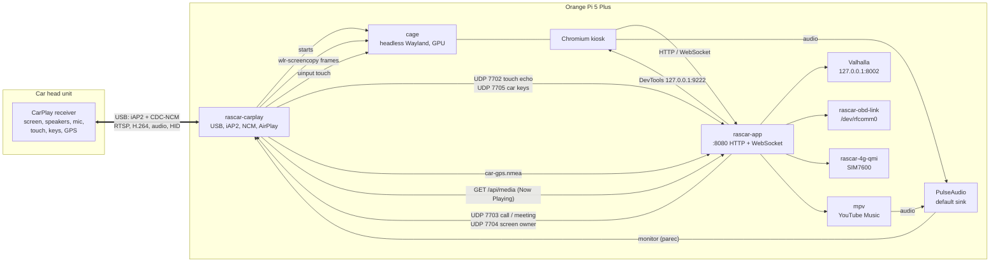
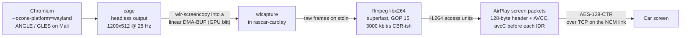
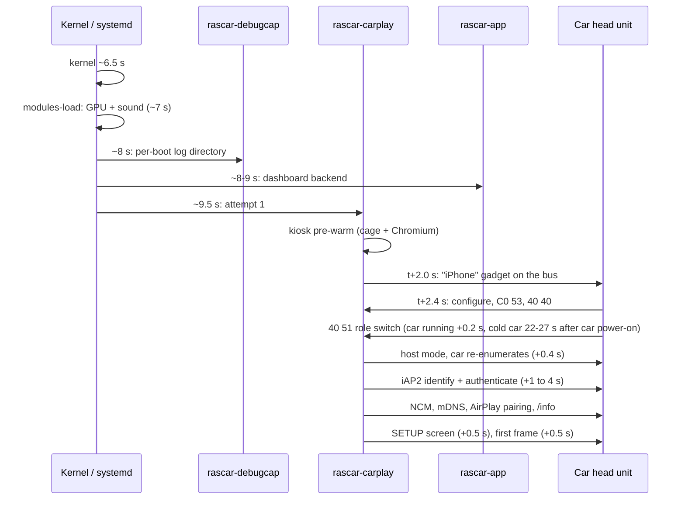

# Architecture

How the pieces on the board fit together: which processes run, how they talk to each other, how the
dashboard reaches the car's screen, and what happens between power-on and the first video frame.

The wire protocol itself (USB role switch, iAP2, CDC-NCM, AirPlay/CarPlay) is in [protocol.md](protocol.md).
The parts and wiring are in [hardware.md](hardware.md).

- [Overview](#overview)
- [Processes and services](#processes-and-services)
- [How they talk: local ports and files](#how-they-talk-local-ports-and-files)
- [The screen path: capture and encode](#the-screen-path-capture-and-encode)
- [Audio, touch and keys](#audio-touch-and-keys)
- [Inside rascar-carplay: the phases](#inside-rascar-carplay-the-phases)
- [Boot sequence and timing budget](#boot-sequence-and-timing-budget)
- [Design rules that shaped this](#design-rules-that-shaped-this)

## Overview

Three programs do the real work:

| Program | Crate | Runs as | Job |
|---|---|---|---|
| `rascar-carplay` | `carplay/` | root | The fake iPhone. USB gadget and role switch, iAP2, CDC-NCM + mDNS, the CarPlay (AirPlay) session, and the streams: screen, audio, touch, keys, car GPS. It also starts the kiosk browser that renders the dashboard. |
| `rascar-app` | `app/` | the normal user | The dashboard: an axum HTTP + WebSocket server on port 8080 serving the frontend (`app/frontend/`) and its APIs: GPS, OBD-II, media, maps and routing, 4G, trips, fuel, phone, settings. |
| Chromium (kiosk) | — | root, started by `rascar-carplay` | Renders `http://localhost:8080` on a headless Wayland compositor (cage). This is what the car sees. |

## Processes and services

All units live in `setup/` and are copied to `/etc/systemd/system/` by `setup/install.sh`, except
`rascar-app.service`, which the installer generates for the account that runs the dashboard.

### Core

| Unit | What it runs | Notes |
|---|---|---|
| `rascar-carplay.service` | `/usr/local/sbin/rascar-carplay-run`, a bash launcher that runs the `rascar-carplay` binary **once per attempt** | `Restart=always`, `RestartSec=20`, `StartLimitIntervalSec=0`: every unplug or failure gets a fresh attempt, forever. Environment from `/etc/rascar/carplay.env`. Each attempt logs to its own file (see [troubleshooting](troubleshooting.md#where-the-logs-are)). The launcher also caps the A76 cores at 1.8 GHz during attempts (`RASCAR_CPU_MAX_KHZ`) and bounds packet captures (`RASCAR_CAPTURE_SECONDS`). A drop-in closes Chromium cleanly on stop so cookies are flushed. `Conflicts=rascar-bridge.service`: the experimental Android Auto bridge uses the same USB controller. |
| `rascar-app.service` | `rascar-app $RASCAR_OPTS` as the user | Options from `/etc/rascar/rascar-app.env`, data from `~/.config/rascar/`. Gets the user's `XDG_RUNTIME_DIR` and session bus so `playerctl`/`pactl` work. |
| kiosk | cage + Chromium, **started by `rascar-carplay`** | With `RASCAR_COMPOSITOR=wayland` (the reference setup). Without it, `rascar-carplay` falls back to Xvfb + Chromium, software rendered. |
| `rascar-valhalla.service` | Valhalla routing server in a podman container, loopback port 8002 | Only if a routing graph exists (`/var/lib/rascar/routing/tiles.tar`, built by `setup/maps/build-routing.sh`). |

Older setups drove a local HDMI screen with `rascar-xorg.service` (an X session), `rascar-kiosk.service`
(Chromium) and `rascar.target`. In CarPlay mode the kiosk belongs to `rascar-carplay`, so the installer
disables those units if it finds them.

### Peripherals

| Unit | Started by | Job |
|---|---|---|
| `rascar-obd-link.service` | boot | Find, pair and bind the ELM327 to `/dev/rfcomm0`. Status in `/run/rascar/obd-link.status`. |
| `rascar-4g-qmi.service` | udev, when `/dev/cdc-wdm0` of the SIM7600 appears (`BindsTo` it) | Dial QMI, apply address/route (metric 2048) and DNS, watchdog. Status in `/run/rascar/4g.status`. |
| `rascar-4g-radio.service` | udev, for the D-Link DWM-222W | Turn its radio on (`AT+CFUN=1`). |
| `gpsd` (system package) | socket | Fallback position source when the car's GPS is not flowing. |

### Board health

| Unit | Job |
|---|---|
| `rascar-thermal.service` | Step the CPU max frequency down at 72/78/83/88 °C; log to `thermal.log`. |
| `rascar-nvme-power.service` | Put the NVMe in operational power state 2 at boot. |
| `rascar-rtc-off.service` | Unbind the battery-less HYM8563 RTC (stuck interrupt line). |
| `systemd-udevd` drop-in `50-rascar-cpuquota.conf` | `CPUQuota=10%`: spreads boot-time driver probes so the supply does not sag. |
| `/etc/modules-load.d/rascar-early-drivers.conf` | Load GPU (panthor) and sound drivers at ~7 s, outside the udev cap. |

### Debugging

| Unit | Job |
|---|---|
| `rascar-debugcap.service` | Starts before `rascar-carplay`. Creates the per-boot directory in `/var/lib/rascar-debug/`, then records kernel log, udev events, usbmon captures, Type-C/UDC state changes, dwc3 trace, mDNS and IP changes. |
| `rascar-earlylog.service` | In `sysinit.target`. For the first 90 s, copies kmsg and the journal to the NVMe and syncs every second, so a boot that dies early still leaves a trace. |
| `rascar-hotspot.service` | Waits up to 45 s for an Ethernet carrier; without one (in the car) it starts a Wi-Fi access point `RasCar-debug` at 10.42.0.1 for SSH. Optional; see [troubleshooting](troubleshooting.md#the-debug-hotspot) for its boot-time cost. |

### Optional

| Unit | Job |
|---|---|
| `rascar-ota-boot.service`, `rascar-agent.service` | Signed OTA updates and log upload to a server you run. Never on the CarPlay start path. See [ota.md](ota.md). |
| `rascar-aa.service` | Experimental Android Auto head unit: shows an Android phone inside a dashboard panel (loopback port 8091). See `experimental/`. |
| `rascar-bridge.service` | Experimental Android Auto *source* (`experimental/bridge/`, not installed by default). Conflicts with `rascar-carplay`. |

## How they talk: local ports and files

Everything between processes stays on loopback or in local files.

| Endpoint | Owner (listens) | Peer | Content |
|---|---|---|---|
| TCP `0.0.0.0:8080` | rascar-app | Chromium (and you, on the bench) | Dashboard HTML/JS, REST APIs, WebSocket for live data |
| TCP `127.0.0.1:8080` `/api/media` | rascar-app | rascar-carplay | Now Playing poll (1 Hz) and artwork, relayed to the car over iAP2 |
| UDP `127.0.0.1:7702` | rascar-app | rascar-carplay | Touch echo, one datagram `p\|d\|r x y` per touch (draws the touch glow; drags at most every 33 ms) |
| UDP `127.0.0.1:7703` | rascar-carplay | rascar-app | Call/meeting line: `call 1`/`call 0`, `ring 1`/`ring 0`, repeated as a heartbeat; a state ends 8 s after its last heartbeat |
| UDP `127.0.0.1:7704` | rascar-carplay (only during a session) | rascar-app | `screen car` / `screen phone`: hand the car's screen back to its native UI or take it again. rascar-app treats "7704 is bound" as "a CarPlay session is live". |
| UDP `127.0.0.1:7705` | rascar-app | rascar-carplay | Steering-wheel / head-unit keys: `key <name>` (next, previous, play, pause, phone keys) |
| TCP `127.0.0.1:9222` | Chromium | rascar-app | Chrome DevTools Protocol: the background YouTube Music tab, embedded apps, reloads |
| TCP `*:7100` | rascar-carplay | the car (in theory) | `_carplay-ctrl` control port advertised on the car link. The Jaguar has never dialled it. |
| TCP `127.0.0.1:8002` | Valhalla | rascar-app | Offline routing |
| TCP `127.0.0.1:2947` | gpsd | rascar-app | Fallback GPS |
| `/var/lib/rascar-debug/car-gps.nmea` | written by rascar-carplay | read by rascar-app | The car's NMEA sentences, checksum-validated |
| `/dev/rfcomm0` | rascar-obd-link binds it | rascar-app | ELM327 serial link |
| `/run/rascar/4g.status`, `/run/rascar/obd-link.status` | the 4G and OBD scripts | rascar-app | One status line each |
| PulseAudio default sink monitor | PulseAudio (user session) | rascar-carplay (`parec`) | Everything the board plays, sent to the car |

The UDP messages are fire-and-forget. Nobody listening is not an error: the dashboard works without a car, and
the CarPlay session works without the dashboard backend.

## The screen path: capture and encode

1. **Render.** `rascar-carplay` starts **cage** (wlroots) with a headless backend and the GLES renderer on
   the Mali GPU (`/dev/dri/renderD128`), in a private runtime directory `/run/rascar-wl`. `wlr-randr`
   sets the output to the car's display size at the stream frame rate. Chromium runs inside it with Wayland
   and ANGLE, so WebGL (the MapLibre map) is hardware accelerated. The kiosk is pre-warmed at service start
   (~2 s after the attempt begins) so the first keyframe is ready the moment the car asks.
2. **Capture.** A small `wlr-screencopy` client (`carplay/src/stream/wlcapture.rs`) requests a full copy of
   the output **every frame**, changed or not; the car wants a steady rate and a damage-driven recorder sent
   nothing on a still page. Copying into a linear DMA-BUF from `/dev/dma_heap/system` is a GPU blit (cage at
   ~5 % of a core); copying into shared memory forces a CPU untile of the Mali's tiled buffer (50-63 %), so
   shm is only the fallback. The next copy is requested before the current frame is written out (double
   buffering), which holds ~24.5-25 fps.
3. **Encode.** Frames go raw to `ffmpeg` (libx264; libopenh264 as a fallback): preset `superfast`
   (`ultrafast` disables deblocking and looked blocky), an IDR every 15 frames, `-b:v`/`-maxrate`/`-bufsize`
   at the target bitrate. Tunables: `RASCAR_VIDEO_FPS` (reference: 25), `RASCAR_VIDEO_BITRATE_KBPS`
   (default 3000), `RASCAR_VIDEO_KEYINT` (default 15). The board's hardware encoder does not do H.264 on
   mainline Linux, so this is software: about 0.5-0.8 of a core.
4. **Packetise and send.** Each access unit becomes an AirPlay screen packet: a 128-byte header (length,
   type, IDR flag, NTP timestamp) and the AVCC payload, encrypted with the session's screen cipher
   (AES-128-CTR on the Jaguar). The SPS/PPS go out as a cleartext `avcC` codec packet before each keyframe.
   When the car sends `forceKeyFrame`, P-frames are held back until the next IDR (at most one GOP). Under
   congestion, every P-frame after a dropped one is dropped until the next IDR, giving a short freeze instead
   of corrupted frames.

The whole pipeline (Chromium, cage, capture, encode) costs about 0.9 of one core on the home page. The older
X11 path (Xvfb + `x11grab`) still works with `RASCAR_COMPOSITOR` unset, but renders WebGL in software.

## Audio, touch and keys

- **Media audio.** Chromium (radio, TV, web pages) and mpv (YouTube Music) play into the user's PulseAudio
  default sink. `rascar-carplay` records its monitor with `parec` and sends it as the CarPlay media stream
  (48 kHz, 16-bit, stereo). Chromium runs as root, so it is given the user session's `PULSE_SERVER` and
  cookie explicitly; without them it played into nothing. Every 10 s the log says
  `audio: level sent to the car … rms=…`, which tells "we sent silence" from "the car muted it".
- **Calls and meetings.** When rascar-app sends `call 1` on 7703, `rascar-carplay` sets up a telephony
  stream. The car plays our audio on its hands-free path and returns its microphone, which appears as a
  PulseAudio source "Car microphone" and becomes the default source for the call. `ring 1` plays a ringtone
  on the car's alert stream.
- **Touch.** The car sends HID reports over the AirPlay event channel. `rascar-carplay` scales them from the
  HID logical range (0..32767) to the dashboard size and injects them through a uinput touchscreen
  (`INPUT_PROP_DIRECT`), which cage passes to Chromium as real touch events. A copy goes to rascar-app on 7702
  for the touch glow.
- **Keys.** Consumer and telephony keypad reports are decoded from the car's own HID descriptors and sent
  as `key <name>` on 7705. rascar-app pushes them to the page over its WebSocket, which applies them to
  whatever is playing.
- **Now Playing.** `rascar-carplay` polls rascar-app's `GET /api/media` once per second and sends the
  track to the car as iAP2 `NowPlayingUpdate`, with the artwork (`/api/media/art`) over an iAP2 file
  transfer session, so the car's own media display shows the current track.

## Inside rascar-carplay: the phases

One process run = one attempt. The log marks each phase (`Phase <X> START` / `END`), which makes failed
attempts easy to place. Details of each step are in [protocol.md](protocol.md).

| Phase | What happens | Ends when |
|---|---|---|
| 1a | Build the configfs gadget with the Apple iPhone identity and the configurations the car expects | Gadget created |
| 1b | Open each configuration's FunctionFS ep0 and write its descriptors | Descriptors written |
| 1c | Bind the gadget to the dwc3 UDC: the car now sees an "iPhone" | Gadget bound (~t+2 s) |
| 1d | Answer the car's control requests (`C0 53` role-switch capability, `40 40` charging, HID descriptor) and wait for the role switch `40 51 wValue=1`. Re-present after 45 s, then every 60 s, if the car configured us but never switched. | Role switch received |
| 3 | Tear the gadget down, switch the OTG port to host (unbind fusb302, dwc3 debugfs `mode`), set the no-LPM quirk, find the car's USB device **on the OTG bus only**, claim the iAP2 interface | USB host transport to the car |
| 2 (over 3) | iAP2 as the device: link layer, identification, authentication. Retried on the same transport if the car drops early. | iAP2 `SessionReady` |
| 4 | Start the iAP2 service loop at once (car GPS, power, Now Playing). Bring up CDC-NCM (patched `cdc_ncm`, IPv6 link-local), find the car's AirPlay receiver over mDNS or straight from the neighbour table | AirPlay endpoint found |
| 4/5 | Pair, `GET /info` (display size, audio formats, HID devices, modes), RECORD, event channel, `modesChanged`, `SETUP screen`, audio streams, keepalive, timing | Streaming; runs until the car or the cable goes away |

The numbering is historical (phase 2 was first written for a device-side transport and later moved on top of
phase 3), but the log markers use it, so it is kept.

When the attempt ends for any reason, the process exits, the gadget is removed and systemd starts the next
attempt 20 s later.

## Boot sequence and timing budget

Measured on the reference build (Armbian, verbose console `loglevel=7`, udev capped at 10 %). `t=0` is
power-on.

| Milestone | Time from power-on | Notes |
|---|---|---|
| Kernel done | ~6.5 s | |
| Userspace (`graphical.target`) | ~9.5 s | `systemd-analyze`: 6.5 s kernel + 3.0 s userspace |
| GPU and sound drivers | ~7 s | Loaded by modules-load, outside the udev cap. Without this the kiosk had no GPU and the car got silence for minutes. |
| `rascar-carplay` attempt 1 | ~9.5 s | Ordered after `rascar-app` and avahi only. Nothing network-related gates it. |
| Gadget visible to the car | ~11.5 s | |
| Role switch | car-dependent | Already-running car: within a second. Cold start: the head unit's own boot, ~22-27 s after it powers up. |
| Dashboard on the car screen | role switch + 2-6 s | |
| udev-published devices (Bluetooth, Wi-Fi, 4G netdev, uinput touch) | 10-45 s | Stretched by the udev cap: ~6 s uncapped, ~20 s at 20 %, ~40 s at 10 %, ~85 s at 5 %. Touch only exists once a session runs. |
| 4G data | ~8-40 s after the modem appears | The script dials as soon as the modem reports packet-service attached. |

In practice, from a cold start, the car's own boot is the longest step, and the board is ready well before
the car asks. When the car is already running (re-plug, or the board restarted), the dashboard is on the
screen about 15-20 s after power-on.

Things that used to break this budget, and must stay off the critical path:

- A unit ordered `After=network-online.target` on the way to `multi-user.target` (it never completes
  without a cable in the car).
- `wpa_supplicant@<wlan>` ordered before `network.target`: the Wi-Fi card takes ~80 s to appear.
- `rascar-hotspot` (waits up to 45 s for Ethernet) — `multi-user.target` waits for it. `rascar-carplay`
  does not.
- An uncapped udev on a weak supply (all probes at ~6 s, NVMe drops) or a 5 % cap (touch and sound up to
  85 s late).

## Design rules that shaped this

- **The car's timing is not negotiable.** The head unit runs its own timers (enumeration, role switch,
  authentication, session establishment) and silently detaches when one expires. Everything on the CarPlay
  path is ordered to be ready before the car asks, and nothing slow (network, Wi-Fi, OTA) is allowed in
  front of it.
- **One attempt per process.** A clean process per attempt means a stuck state can never leak into the
  next try. systemd gives the retry loop for free.
- **Assume power disappears at any moment.** No shutdown hook is possible, so writes are made durable early
  and logs that matter go to the NVMe, synced.
- **Instrument first.** Every attempt leaves a full trace (USB, network, kernel, our own wire trace) on the
  NVMe, because car time is scarce and most failures cannot be reproduced at a desk.
- **Prefer the car's data.** GPS, microphone, speakers, screen and keys all come from the car, so the
  hardware stays minimal.
