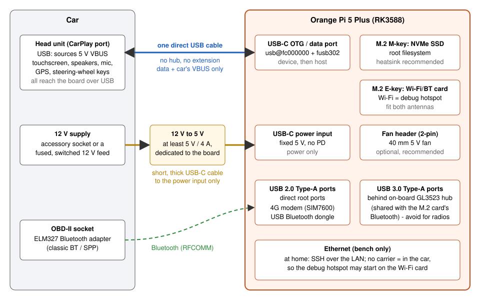

# Hardware

This page lists what to buy and how to connect it. Everything here was learned on one reference build that
has been used for daily driving. Where a recommendation goes beyond what that build has proven, the text
says so.

- [Parts list](#parts-list)
- [Wiring](#wiring)
- [The board](#the-board)
- [Storage (NVMe)](#storage-nvme)
- [Power](#power)
- [The car link (USB-C OTG port and cable)](#the-car-link-usb-c-otg-port-and-cable)
- [Cooling](#cooling)
- [Real-time clock](#real-time-clock)
- [Wi-Fi and Bluetooth](#wi-fi-and-bluetooth)
- [OBD-II adapter](#obd-ii-adapter)
- [4G modem](#4g-modem)
- [GPS, microphone, speakers, display](#gps-microphone-speakers-display)
- [USB port map](#usb-port-map)

## Parts list

| Part | Role | Required? | Tested model | Notes |
|---|---|---|---|---|
| Orange Pi 5 Plus | Runs everything; its USB-C OTG port plays the iPhone | **Yes** | Orange Pi 5 Plus, 16 GB RAM | The USB role switch code targets the RK3588 dwc3 controller at `fc000000.usb`. Other boards need porting. |
| NVMe SSD (M.2 2280, M-key) | Root filesystem, maps, logs | **Yes** | Samsung 970 EVO 1 TB | The reference install uses ~70 GB. A heatsink is recommended. See [Storage](#storage-nvme). |
| 5 V supply for the board | Powers the board | **Yes** | 12 V accessory-socket USB-C chargers (see [Power](#power)) | **The car's USB port is not enough.** The board wants 5 V / 4 A. |
| USB cable, car to board | The CarPlay link | **Yes** | Short, direct cable | Goes from the car's CarPlay USB port to the board's **USB-C OTG** port. No hub, no extension. |
| M.2 E-key Wi-Fi/BT card + 2 antennas | Debug hotspot (SSH in the car), Wi-Fi client at home | Recommended | Realtek RTL8852BE card | Fit both u.FL antennas. Without them the radio is about 40 dB weaker than a laptop. |
| USB Bluetooth dongle | Talks to the OBD-II adapter | Needed for OBD-II | TP-Link UB500 (Realtek RTL8761BU, `2357:0604`) | Needs firmware from Debian's `firmware-realtek` (the installer extracts it). |
| ELM327 Bluetooth OBD-II adapter | Engine data | Optional | Generic "OBDII" ELM327 v1.5 clone, classic Bluetooth, legacy PIN | Must be **classic Bluetooth (SPP/RFCOMM)**. BLE-only adapters do not work. |
| 4G modem | Internet in the car (traffic, music, radio), calls | Optional | SIMCom SIM7600E-H USB stick (`1e0e:9001`, QMI) | Peaks at ~2 A while transmitting. Plug it straight into a USB 2.0 port. |
| Fan, 40 mm, 5 V | Keeps the SoC and SSD cool in a closed car | Recommended | None fitted on the reference build | The board has a 2-pin fan header. See [Cooling](#cooling). |
| Ethernet cable | Bench work at home | Optional | | With a carrier at boot the debug hotspot stays off. |
| HDMI monitor | Reading the kernel console when a boot fails | Optional, bench only | | The board does not need a display in the car. |

Not needed: a GPS receiver (the car sends its position), a microphone (the car's microphone is used), a
display or touchscreen (the car's screen is the display), an MFi authentication chip.

## Wiring



The same in text:

```
  Car CarPlay USB port ──── one direct USB cable ────► board USB-C OTG port (usb@fc000000)
                           (data + car's own VBUS)

  12 V socket / fused 12 V ──► 12 V → 5 V supply (≥ 5 V / 4 A) ──► board USB-C power input

  OBD-II socket: ELM327 ···· Bluetooth ····► USB BT dongle ──► board USB 2.0 port
  4G modem (SIM7600) ────────────────────────────────────────► board USB 2.0 port
  M.2 E-key Wi-Fi/BT card + 2 antennas ──► debug hotspot "RasCar-debug" (10.42.0.1)
  M.2 M-key NVMe SSD (with heatsink)
  40 mm fan ──► board 2-pin fan header (optional)
```

The two USB-C ports on the board have different jobs. Never swap them:

| Board port | Connect to | Why |
|---|---|---|
| USB-C **power** input | Your 5 V supply | Fixed 5 V input. It does not negotiate USB-PD. |
| USB-C **OTG / data** port (`usb@fc000000`, with the fusb302 Type-C controller) | The car | The only port that can switch from device to host mode. |

## The board

**Orange Pi 5 Plus** (Rockchip RK3588: 4x Cortex-A76 + 4x Cortex-A55, Mali-G610 GPU).

The reference build runs Armbian 25.11 (Debian trixie) with the mainline `6.18.x-current-rockchip64`
kernel. The patch in `kernel/cdc_ncm/` is built against that kernel.

**RAM.** The reference board has 16 GB. With everything running (dashboard, kiosk Chromium, Valhalla
routing, CarPlay stream) it uses about 1.2 GB plus page cache. 8 GB should be plenty and is a reasonable
minimum to buy. 4 GB will probably work but has not been tried.

**Why this board.** Its USB-C port is wired to a dwc3 controller that can be switched between device and
host mode at runtime. That switch is the heart of wired CarPlay: the board must first enumerate as an iPhone
(device), then become the USB host when the car asks. Mainline Linux also gives a working GPU (panthor)
for the kiosk.

**What the CPU does in a session** (measured): the H.264 software encode of the 1200x512 dashboard at
25 fps costs about 0.5 to 0.8 of one core (libx264 `superfast`). The board's hardware encoder is not usable
for H.264 on mainline (it only does JPEG there). Everything together stays near one core.

## Storage (NVMe)

The NVMe SSD holds the root filesystem. It caused most of the hard failures of the project, so read this part.

**The drive drops off PCIe when the 5 V supply sags.** The symptom is `nvme nvme0: controller is down; will
reset: CSTS=0xffffffff` in the kernel log, then ext4 I/O errors and a read-only root filesystem. Running
programs die with `SIGBUS` or `Input/output error`. It happened:

- under heavy load (package installs, compiling on the board) while the board ran from the car's own USB port,
- the same on a 12 V accessory-socket USB-C charger,
- at boot, about 6 s in, when all drivers probe at once (see [troubleshooting](troubleshooting.md)),
- after the board overheated during a sustained full-CPU load.

What the setup does about it:

- Kernel arguments `nvme_core.default_ps_max_latency_us=0 pcie_aspm=off pcie_port_pm=off` turn off NVMe
  autonomous power states and PCIe link power management. An early drop happened on a low-power exit.
  These arguments did not prevent the later drops, which points at power, but they remove one failure mode.
- `rascar-nvme-power.service` caps the drive at **operational power state 2** at every boot
  (`nvme set-feature /dev/nvme0 --feature-id=2 --value=2`). On a Samsung 970 EVO that is 2.1 W max
  instead of 6.2 W, with zero entry/exit latency (not a sleep state). The controller temperature fell from
  75 to 69 °C. Sequential writes drop to ~186 MB/s, far more than the system needs (~100 KiB/s).
  The drive forgets this at power-off, so the unit re-applies it.
- `systemd-udevd` is CPU-capped at boot (`setup/boot/50-rascar-cpuquota.conf`, `CPUQuota=10%`) so the
  driver probes are spread out instead of all running at ~6 s.
- **Never compile or install packages on the board while it runs on car power.** Cross-compile on a PC
  (`cargo zigbuild --target aarch64-unknown-linux-gnu.2.36`) and copy the binaries.

**Heat.** At idle the drive in PS0 ran at 55-58 °C (composite) and 72-75 °C on the controller sensor, with
a heatsink and no airflow. Use a heatsink, and a fan if you can.

**Power cuts.** The car cuts power without warning every time it is switched off. To make that safe, the
installer sets `fsck.repair=yes` on the kernel command line and short writeback timers
(`vm.dirty_expire_centisecs=300`, `vm.dirty_writeback_centisecs=100`), and the programs write their
settings with temp-file + fsync + rename. Its "power-cut hardening" step (on by
default) also mounts the root filesystem with `commit=5` (Armbian's default keeps minutes of writes in RAM), disables `armbian-ramlog` and keeps a persistent journal synced every 5 s. The last ~3-5 s of writes can still be lost. A clean shutdown would need
ignition sensing plus a hold-up supply (supercap or UPS HAT). None was built.

## Power

**The car's USB port is not enough, and neither is a typical car USB-C charger.**

Facts from the board's device tree and the vendor documentation:

- The board's power input is a fixed **5 V** rail with no USB-PD controller behind it. The official
  requirement is **5 V / 4 A**.
- A USB-PD charger therefore only gives the board its default 5 V profile, usually at most 3 A,
  however many watts are printed on it.
- The only Type-C controller (fusb302) sits on the OTG data port, so Linux cannot read what the power
  input negotiated. There is no undervoltage message to look for.

What was tried on the reference build:

| Supply | Result |
|---|---|
| The car's built-in USB-C port | NVMe dropped four times under load in one evening. |
| 12 V accessory-socket USB-C PD charger | NVMe still dropped under load, and 8 of 22 car boots died ~6 s in once the udev cap had been removed. |
| A 100 W 12 V USB-C charger, with udev capped | No dead boot and no NVMe error in the boots observed since. Not long enough to call it solved. |

**Recommendation (not yet proven on the reference build).** Feed the board from a dedicated 12 V to 5 V
step-down converter rated for at least 5 A continuous, wired to a fused, switched 12 V source, with a short
and thick cable to the board's USB-C power input. Power the board only from that supply. Once the board has
a solid supply, the udev CPU cap can be relaxed (it delays touch, sound and 4G at boot).

**Do not power the board from the car's CarPlay port.** That port belongs to the car link. The car does
announce a 2100 mA budget for its "phone" over iAP2, but that is meant for charging an iPhone, not for a board
with an NVMe drive.

**Do not back-feed VBUS.** On the OTG port the car is the power source, even after the board becomes the
USB host. The board's own `vbus5v0_typec` regulator stays disabled. Enabling it would connect two 5 V
sources together.

**Peripheral current.** The SIM7600 modem draws up to ~2 A in bursts while transmitting. Count it in your
supply budget.

## The car link (USB-C OTG port and cable)

Connect the car's CarPlay-capable USB port to the board's **USB-C OTG port** (the one wired to
`usb@fc000000`, managed by the fusb302 Type-C controller on I2C bus 6). Use whichever cable fits the car's
socket (USB-A to C or C to C).

Rules learned the hard way:

- **One direct cable.** No hub, no extension, no adapter chain. Marginal cables cause `disabled by hub
  (EMI?)` and `error -71` on the car link and on other USB devices.
- Use a short, good quality USB 2.0 high-speed capable cable. The car link runs at 480 Mbit/s.
- The board must reach the car with the right USB identity before anything else happens. The software
  handles this; the cable just has to be clean.

What happens on that cable is described in [protocol.md](protocol.md). In short: the board enumerates as an
iPhone, the car sends the role-switch request, the software unbinds the fusb302 driver and switches the dwc3
controller to host mode, and the car re-enumerates as a USB device (on the Jaguar: `8086:9999` "Gadget MFi
v0.1").

## Cooling

The board has no fan by default, and the reference build still has none. That is a weakness:

- On a sustained full load (an Android emulator's first boot) the board became too hot to touch, the NVMe
  dropped and the root filesystem went read-only.
- The device tree only defines fan trips at 55/65 °C and a critical trip at 115 °C. Nothing throttles the
  CPU in between.
- Its `cooling-levels` cap the fan output at 39 % duty. A fan on the header would never run at full speed
  without a device tree overlay that raises those levels (for example `0 120 170 220 255`). This overlay is
  not part of the repository yet.

What the setup does: `rascar-thermal.service` lowers the CPU maximum frequency in steps when the hottest
sensor crosses 72 / 78 / 83 / 88 °C (5 °C hysteresis; NVMe counted 5 °C lower) and logs to
`/var/lib/rascar-debug/thermal.log`. In normal driving the SoC stays around 45-60 °C.

**Recommendation:** a 40 mm 5 V fan on the board's 2-pin fan header, a metal case or heatsink kit for the
RK3588, and a heatsink on the NVMe. A fan wired straight to 5 V/GND pins also works but always runs at full speed.

## Real-time clock

The board has an HYM8563 RTC (I2C bus 6, address 0x51) but **no backup battery**. Without a battery:

- The RTC never holds a valid time (`hctosys: unable to read the hardware clock`).
- Its interrupt line sits stuck active. That gave ~4,500 interrupts per second and a load average of ~1.5
  on an idle board.

So the setup disables it: `rascar-rtc-off.service` unbinds the driver at boot and
`/etc/modprobe.d/rascar-no-hym8563.conf` blacklists it. Time comes from NTP when online, from the car's GPS
(`$GPRMC` over iAP2) in the car, and from `fake-hwclock` in between.

If you fit a coin cell, remove both, then check the interrupt rate in `/proc/interrupts` before trusting it.

## Wi-Fi and Bluetooth

The Orange Pi 5 Plus has no radio on the board itself. The reference build uses an **M.2 E-key Realtek
RTL8852BE** card: Wi-Fi over PCIe (`rtw89_8852be`), Bluetooth over USB (`0489:e123`, shown by `lsusb` as
"Foxconn / Hon Hai Bluetooth Radio").

**Fit both antennas.** Without them the card heard a beacon at -102 dBm where a USB dongle next to it
heard -62 dBm, and it never reached the OBD adapter in the car.

**Wi-Fi** is used for:

- the **debug hotspot** in the car (`rascar-hotspot`, SSID `RasCar-debug`, board at `10.42.0.1`,
  passphrase generated at install in `/etc/rascar/hotspot.pass`),
- an optional Wi-Fi client at home or on a phone hotspot.

**Bluetooth** uses a **USB dongle** instead of the card: a **TP-Link UB500** (Realtek RTL8761BU,
`2357:0604`, BT 5.1). The on-board controller is switched off by USB id
(`setup/bluetooth/70-rascar-bt-onboard-off.rules` sets `authorized=0` on `0489:e123`) so the dongle is
the only, and therefore default, controller for `bluetoothctl`. It still shows in `lsusb`, because an
unauthorised device stays enumerated. The dongle needs `rtl_bt/rtl8761bu_fw.bin` and
`rtl8761bu_config.bin`. Armbian's firmware package does not ship them and conflicts with Debian's
`firmware-realtek`, so `setup/install.sh` extracts just those two files.

Where to plug the dongle: on the reference build it sat on a USB 3.0 Type-A port, behind the on-board
GL3523 hub. It fell off the bus 21 times in 4.1 hours of driving (`disabled by hub (EMI?)`,
`error -71`, sometimes `unable to enumerate USB device`). Each time the OBD link dropped. Prefer a
**USB 2.0 root port** (see the [USB port map](#usb-port-map)). That this cures it is a reasonable
expectation, not yet a measured result.

## OBD-II adapter

Any **ELM327-compatible adapter with classic Bluetooth (SPP)** should work. The tested one is a cheap
"OBDII" ELM327 v1.5 clone with legacy PIN pairing. BLE-only adapters have no RFCOMM channel and will not work.

`rascar-obd-link.service` (script `setup/obd/rascar-obd-link`) does the pairing and binding:

1. Picks the adapter address: `OBD_MAC` in the unit, else the adapter chosen in the dashboard
   (Settings > Bluetooth), else the first device whose name looks like an OBD adapter
   (OBD, ELM, V-LINK, VGATE, KONNWEI, VEEPEAK, CARISTA, OBDLINK).
2. Pairs with a legacy PIN from `/etc/rascar/obd-pins` (default `1234`, then `0000`), trusts it.
3. Binds it to `/dev/rfcomm0`, which `rascar-app` reads (`--obd-port`), and re-binds when the node goes away.

The installer also sets BlueZ `LinkSupervisionTimeout=3200` (2 s instead of 20 s). When the dongle drops
off USB, the adapter otherwise keeps the dead link for 20 s and every reconnect takes 20-55 s.

The adapter stays plugged in. Its MCU survived every Bluetooth drop in testing, so the app reconnects without
a full re-initialisation.

## 4G modem

**Tested and kept: SIMCom SIM7600E-H USB stick** (`1e0e:9001`, Qualcomm based).

- Interfaces: QMI (`qmi_wwan`, `/dev/cdc-wdm0` + a `wwu…` netdev), AT ports `ttyUSB2`/`ttyUSB3`,
  NMEA on `ttyUSB1`, PCM audio on `ttyUSB4` (used for calls).
- `rascar-4g-qmi.service` is started by udev when `cdc-wdm0` appears and stopped when it goes. It dials
  raw-IP with `qmicli` (empty APN = network default), sets the default route with **metric 2048** so
  Ethernet and Wi-Fi stay preferred, and watches link + address + route every 20 s.
- Only one program may talk QMI. `qmi-proxy` once spun at 100 % CPU and wedged every call, so the script
  calls `qmicli` directly under a lock.
- Power: up to ~2 A peaks on transmit. The SIMCom datasheet asks for more than 300 µF of bulk capacitance
  on its supply.
- Plug it **directly** into a USB 2.0 port. With a USB extension cable the modem dropped off the bus
  every few minutes (and disturbed the Bluetooth dongle on the same hub). Without it the errors stopped.

**Tried and dropped:**

| Device | Why it was dropped |
|---|---|
| Generic LTE stick `3566:2001` | Reset itself ~2 s after every enumeration, on any host (also on a laptop). Faulty stick or firmware. |
| D-Link DWM-222W (ASR PXA1802 "UFI Wireless Router", `1286:4e31`) | Works as a USB router (CDC-ECM, DHCP) but boots with its radio off (`AT+CFUN=4`; `setup/4g/rascar-4g-radio` switches it on). It also broadcasts its own Wi-Fi access point with a factory password and has a default web admin login. It has no audio path to the host, and a test voice call crashed its firmware. Not usable for calls, so the SIM7600 replaced it. The udev rule and radio helper remain for anyone who owns one. |

The CarPlay code ignores every USB device that is not on the OTG controller's bus (`fc000000.usb`). This was
added after a 4G stick with a vendor-class bulk interface was claimed as "the car".

## GPS, microphone, speakers, display

**GPS: no receiver needed.** The car streams its own position over iAP2 (`LocationInformation`, one NMEA
sentence per message, about 1 Hz): `$GPGGA`, `$GPRMC`, `$GPGSV` and Apple's `$PASCD` (speed, distance,
gear). On the Jaguar the fix is the car's fused position (GGA fix quality 6, dead reckoning), so it keeps
working in tunnels and car parks. `rascar-carplay` validates the checksums and appends the sentences to
`/var/lib/rascar-debug/car-gps.nmea`. `rascar-app` reads that file first and falls back to `gpsd` on
`127.0.0.1:2947` when it goes quiet, so a USB GPS receiver still works on the bench.

**Microphone: the car's.** During a call or meeting the session switches to a CarPlay telephony audio
stream and the car sends its microphone audio (8/16/24 kHz mono on the Jaguar).

**Speakers: the car's.** Media audio goes to the car as a 48 kHz 16-bit stereo CarPlay audio stream,
captured from the board's PulseAudio default sink monitor.

**Display and touch: the car's.** The dashboard is streamed to the car's screen at its native size
(1200x512 on the Jaguar). Touches and steering-wheel keys come back as HID reports.

## USB port map

Check yours with `lsusb -t`. On the reference board:

| Bus | Controller | What it is |
|---|---|---|
| 1 (USB 2.0) / 2 (USB 3.0) | xHCI, Genesys GL3523 hub (`05e3:0610` / `05e3:0620`) | The two USB 3.0 Type-A ports, plus the M.2 E-key card's Bluetooth (`0489:e123`, hub port 1). |
| 3, 5 (EHCI) and 4, 6 (OHCI) | Direct root ports | The two USB 2.0 Type-A ports (high speed on EHCI, full speed on OHCI). |
| OTG (`fc000000.usb`) | dwc3, role-switchable | The USB-C data port. The car appears here after the role switch (bus 7 on the reference build). |

Put the radios (4G modem, Bluetooth dongle) on the **USB 2.0 root ports**. Two devices on the GL3523 hub
failed together during the hub-error episodes, which points at the hub's shared path.
